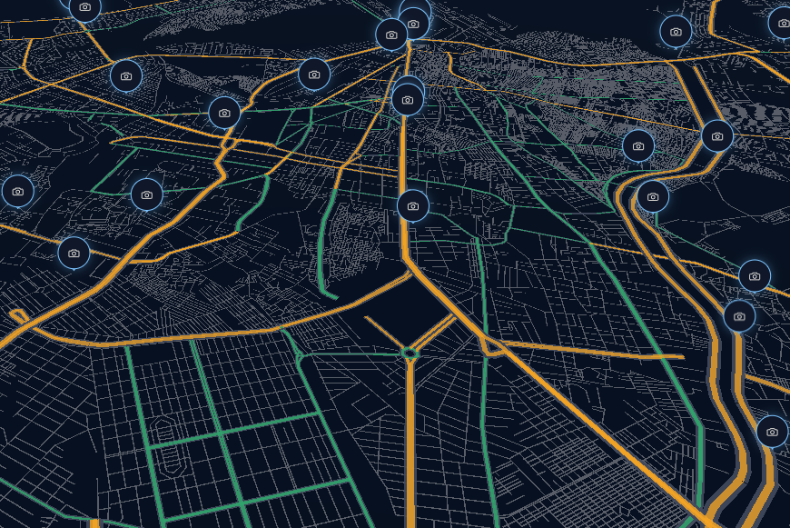
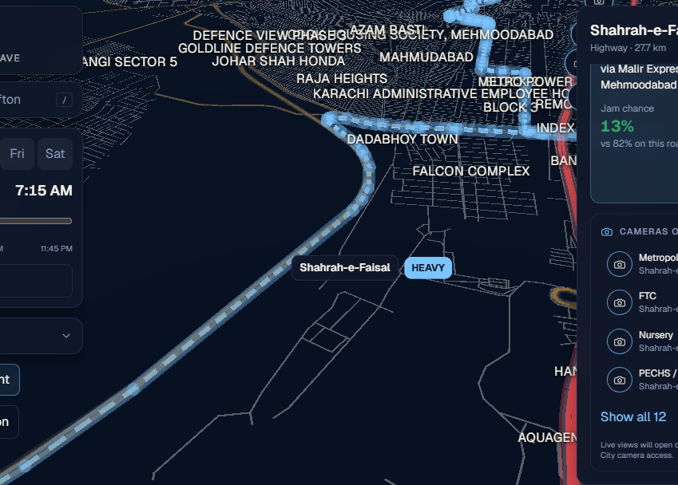
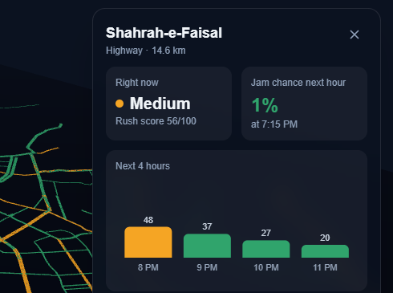
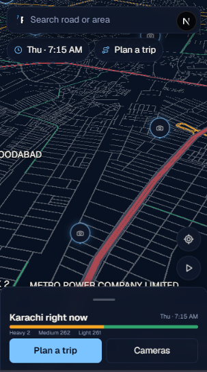
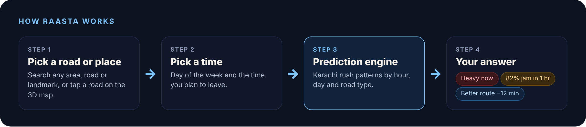
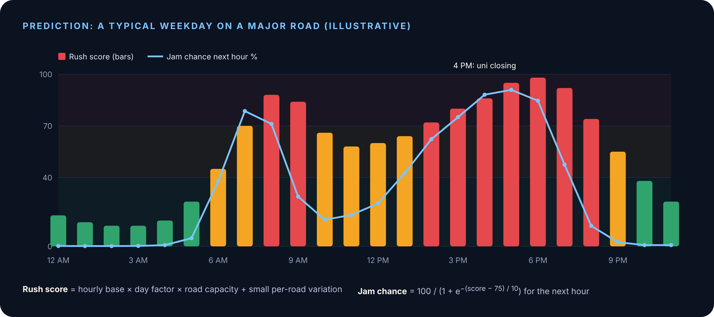
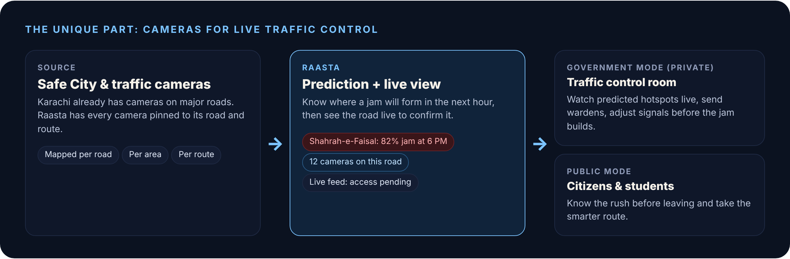
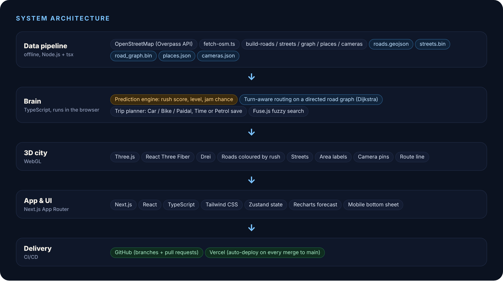

<p align="center">
  
</p>

<p align="center">
  <b>Know the rush before you leave.</b><br>
  A 3D traffic <b>prediction system</b> for Karachi.
</p>

<p align="center">
  <a href="https://raasta-traffic-predictor-simulator.vercel.app/"><b>Live app</b></a> ·
  <a href="#getting-started">Run locally</a> ·
  <a href="#how-the-prediction-works">How prediction works</a> ·
  <a href="#team">Team Peak Hour Pandas</a>
</p>

---

## Table of contents

1. [What is Raasta?](#what-is-raasta)
2. [Not a map: a prediction system](#not-a-map-a-prediction-system)
3. [Features](#features)
4. [Screenshots](#screenshots)
5. [How it works](#how-it-works)
6. [How the prediction works](#how-the-prediction-works)
7. [Routing](#routing)
8. [Cameras and government use](#cameras-and-government-use)
9. [Tech stack](#tech-stack)
10. [Architecture](#architecture)
11. [Project structure](#project-structure)
12. [Getting started](#getting-started)
13. [Rebuilding the map data](#rebuilding-the-map-data)
14. [Deployment](#deployment)
15. [Limitations](#limitations)
16. [Roadmap](#roadmap)
17. [Team](#team)
18. [Acknowledgements](#acknowledgements)

---

## What is Raasta?

It's 4 PM. A student leaves university and heads for Shahrah-e-Faisal. Twenty minutes later she's stuck in a jam that forms at almost the same time every weekday, and nothing warned her.

**Raasta** (Urdu for *the way*) fixes that. Pick a road and the time you plan to leave, and Raasta tells you:

- **Right now:** how heavy the rush is on that road (light, medium or heavy, score out of 100)
- **Next hour:** the chance of a jam in the next hour, plus a 4-hour forecast
- **Better route:** a smarter way to go, with its own jam chance and the minutes you save

All of it inside an interactive 3D model of Karachi's real road network.

Built for the **Youth Empowerment Hackathon 2026** by **Team Peak Hour Pandas**.

## Not a map: a prediction system

Raasta is **not another map app**. You can call the 3D city a map feature, but the product is a **prediction system**.

| Map apps | Raasta |
|---|---|
| Show traffic as it is right now | Predicts the rush for the time **you** plan to leave |
| Global and generic | Built around Karachi's patterns: university and office closing, school runs, Friday prayers, evening peak |
| Coloured lines | A clear jam chance (%) and a recommended alternative |
| Flat 2D | Interactive 3D city |

It answers the question no map in Karachi answers: *"If I leave at this time, how bad will this road be, and what's the smarter way?"*

## Features

- **3D Karachi:** the full city road network (main roads, highways and streets) from DHA Phase 8 to Surjani and Hawksbay to Quaidabad, in interactive 3D
- **Rush colours by time:** every road recolours for the day and time you pick
- **Jam chance + 4-hour forecast** for any road
- **Smart search:** roads, areas, streets and landmarks, typo-tolerant (e.g. "shahra faisal" finds Shahrah-e-Faisal)
- **Trip planner:** From/To, **Car / Bike / Paidal**, **Time save / Petrol save**, better route with jam chance and minutes saved
- **Turn-aware routing:** respects one-way roads, median cuts and U-turns
- **Cameras on every road and route:** pins appear when you zoom in, hover to preview, click for full screen
- **Area labels** with level of detail (big areas first, neighbourhoods as you zoom in)
- **My location**, **demo mode**, and an **"Explore the rush"** intro with automatic zoom
- **Mobile-first layout:** search bar, chips and a draggable bottom sheet

## Screenshots

| 3D city with camera pins | Better route |
|---|---|
|  |  |

| Road prediction panel | Mobile |
|---|---|
|  |  |

## How it works



1. **Search or tap** a road, area or landmark. The camera flies to it.
2. **Pick when you're leaving** (day + time). Every road recolours.
3. **Read the prediction:** rush now, jam chance next hour, 4-hour forecast.
4. **Plan a trip:** Raasta draws the better route and compares it with the busy road you avoided.
5. **Check the cameras** on that road or route.

## How the prediction works



Every road gets a **rush score (0-100)** for any day and minute:

```
score(road, day, time) = hourlyBase(roadType or road override, time)
                         × dayFactor(day, time)
                         × capacityFactor(roadType)
                         + small stable per-road variation        (clamped 0-100)
```

- **Hourly base:** 24 values per road type (highway, arterial, local), tuned to Karachi: morning peak 8-10, school and university closing 1-4 PM, evening office peak 5-8 PM, quiet late night. Major roads (Shahrah-e-Faisal, University Road, M.A. Jinnah Road, Rashid Minhas Road, Shahrah-e-Pakistan, Korangi Road, Lyari Expressway, I.I. Chundrigar Road) have their own profiles.
- **Day factor:** weekdays heaviest, Saturday moderate, Sunday lighter, Friday dip around prayer time then a surge.
- **Minutes:** values are interpolated between hours.

**Levels:** light < 40 · medium 40-70 · heavy > 70

**Jam chance in the next hour:**

```
jamChance = 100 / (1 + e^(-(scoreNextHour - 75) / 10))
```

Calibrated so peak Shahrah-e-Faisal is ~91% while Rashid Minhas Road is ~61%, so the alternative is clearly better.

The engine is a **pure, synchronous TypeScript function** with all numbers in one config object. A model trained on real sensor or GPS data can replace it later behind the same interface.

## Routing

- Road network from **OpenStreetMap**, converted into a compact **directed road graph** (`road_graph.bin`).
- **Turn-aware:** respects one-way roads and only turns where turning is possible (median cuts, U-turns on dual roads).
- **Dijkstra** shortest path where each edge is weighted by its **predicted rush** at the departure time, not just its length.
- **Modes:** Car, Bike, Paidal (walking), each with allowed roads and speeds.
- **Goals:** Time save (fastest) or Petrol save (shorter, calmer).

## Cameras and government use



Raasta already maps Karachi's traffic cameras to their **roads, areas and routes**. Today each feed shows **"Live feed restricted"** because public access has not been granted.

**If the government grants camera access**, Raasta becomes a **traffic control tool**: the prediction shows *where* a jam will form in the next hour, and the live camera shows *what is happening now*, so wardens can be sent and signals adjusted **before** the jam builds. Raasta can run as a **private government version** for the traffic control room, and stay a public app for citizens.

## Tech stack

| Technology | Role | How we used it |
|---|---|---|
| **Next.js** (App Router, Turbopack) | App framework | Pages, build, production optimisation |
| **React** + **TypeScript** (strict) | UI + type safety | All components; shared types across data, prediction and routing |
| **Three.js** | 3D engine (WebGL) | Roads, streets, labels, camera pins, route line |
| **React Three Fiber** + **Drei** | 3D in React | Scene as components, camera controls, smooth fly-to, labels |
| **Tailwind CSS** | Styling | Dark design system, responsive layouts, mobile bottom sheet |
| **Zustand** | State | One store for road, time, filters, trip and cameras |
| **Recharts** | Charts | 4-hour forecast |
| **Fuse.js** | Search | Fuzzy search over roads, areas and landmarks |
| **OpenStreetMap** + **Overpass API** | Map data | Roads, streets, places and camera locations for Karachi |
| **Node.js** + **tsx** | Data pipeline | Fetch, clean, simplify and convert OSM data into GeoJSON, JSON and binary files |
| **Dijkstra** on a directed graph | Routing | Turn-aware, rush-weighted shortest path |
| **GitHub** + **Vercel** | Teamwork + hosting | Branches and pull requests; auto-deploy on every merge to `main` |

## Architecture



```
OpenStreetMap (Overpass) ──► scripts/*.ts (Node + tsx) ──► public/data/*
                                                          │  roads.geojson, streets.bin,
                                                          │  road_graph.bin, places.json, cameras.json
                                                          ▼
                       Browser: Next.js + React
                       ├── src/lib        prediction, routing, search, data loading
                       ├── src/store      Zustand app state
                       ├── src/components/three   3D city (Three.js / R3F / Drei)
                       └── src/components/ui      panels, search, trip planner, cameras
                                                          ▼
                                        Vercel (auto-deploy from main)
```

Everything runs in the browser. There is no backend server, so the app is fast and cheap to host.

## Project structure

```
.
├── public/
│   ├── data/                 # generated map data (roads, streets, graph, places, cameras)
│   ├── icon.png, raasta_logo_header.svg
├── scripts/                  # data pipeline (run with npx tsx)
│   ├── fetch-osm.ts          # download Karachi data from OpenStreetMap
│   ├── build-roads.ts        # main roads -> roads.geojson
│   ├── build-streets.ts      # streets -> streets.bin
│   ├── build-graph.ts        # directed, turn-aware road graph -> road_graph.bin
│   ├── build-places.ts       # areas, landmarks -> places.json
│   └── build-cameras.ts      # camera locations -> cameras.json
├── src/
│   ├── app/                  # Next.js app (page.tsx, layout.tsx, icon)
│   ├── components/
│   │   ├── three/            # Scene, Roads, Streets, CameraRig, CameraPins, PlaceLabels, RouteLine...
│   │   ├── ui/               # SearchBar, TimePicker, SidePanel, TripPlanner, TripPanel, CameraModal...
│   │   └── layout/           # desktop and mobile layouts
│   ├── lib/                  # types, api, roads, prediction, routing, roadGraph, places, cameras, trip
│   └── store/useAppStore.ts  # Zustand store
└── README.md
```

## Getting started

**Requirements:** Node.js 20+ (LTS), npm, Git.

```bash
git clone https://github.com/ArmaanAkhtar/RAASTA--TrafficPredictorSimulator.git
cd RAASTA--TrafficPredictorSimulator
npm install
npm run dev
```

Open <http://localhost:3000>.

Other commands:

```bash
npm run build        # production build (same as Vercel)
npm run start        # run the production build
npx tsc --noEmit     # type check
```

> **Windows PowerShell:** if `npx` is blocked, run once:
> `Set-ExecutionPolicy -Scope CurrentUser -ExecutionPolicy RemoteSigned`.
> If `npm install` warns that esbuild's install script was not approved, run `npm install-scripts approve esbuild` and `npm rebuild esbuild`.

## Rebuilding the map data

The generated data is already in `public/data/`, so you only need this to refresh it. It needs internet access (Overpass API). Run the scripts in this order:

```bash
npx tsx scripts/fetch-osm.ts
npx tsx scripts/build-roads.ts
npx tsx scripts/build-streets.ts
npx tsx scripts/build-graph.ts
npx tsx scripts/build-places.ts
npx tsx scripts/build-cameras.ts
```

The bounding box covers greater Karachi (about lat 24.74-25.15, lon 66.80-67.40). Coordinates are stored as local metres around lat 24.8607, lon 67.0011 and rendered in 3D as `(x, 0, -y)`.

## Deployment

The app is deployed on **Vercel**, connected to this repository:

- Every push or merge to `main` triggers an automatic production deploy.
- If a build fails, Vercel keeps serving the last working version. Run `npm run build` locally first.
- Live: <https://raasta-traffic-predictor-simulator.vercel.app/>

## Limitations

1. **Static predictions:** based on Karachi's typical rush patterns, not live sensor or GPS data. Accidents, protests and weather are not detected.
2. **Karachi only:** the data, road network and rush profiles are built for Karachi.
3. **No camera access yet:** camera locations are mapped, but live feeds need government (Safe City) permission.
4. **OpenStreetMap coverage:** some small streets or new areas may be missing or misnamed where OSM is incomplete.

## Roadmap

- Government partnership: Safe City camera access and a private control-room version
- Live traffic data feeding the same prediction interface, and a trained ML model
- Lyari Expressway-aware routing with toll per vehicle type
- "Leave in 20 minutes" alerts for saved routes (home to university)
- More cities: Lahore and Islamabad

## Team

**Peak Hour Pandas**

- Armaan Akhtar
- Hamza Safdar
- Ahmed Uzair Mughal
- Farhan Abid

## Acknowledgements

- Map data © [OpenStreetMap](https://www.openstreetmap.org/copyright) contributors, available under the Open Database License (ODbL).
- Built with Next.js, React, Three.js, React Three Fiber, Drei, Tailwind CSS, Zustand, Recharts and Fuse.js.
